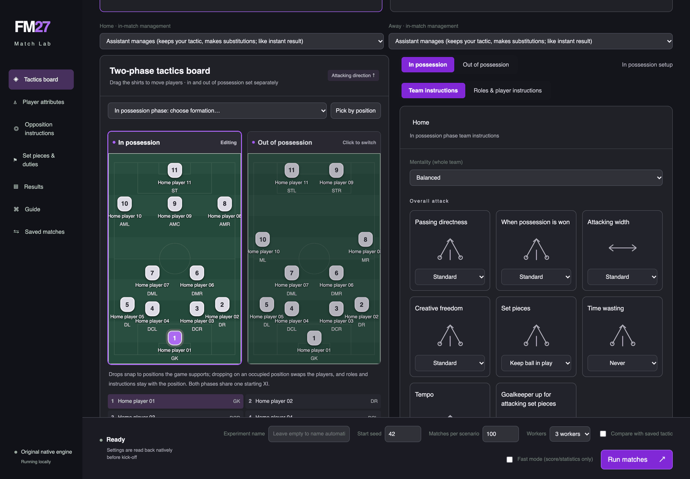
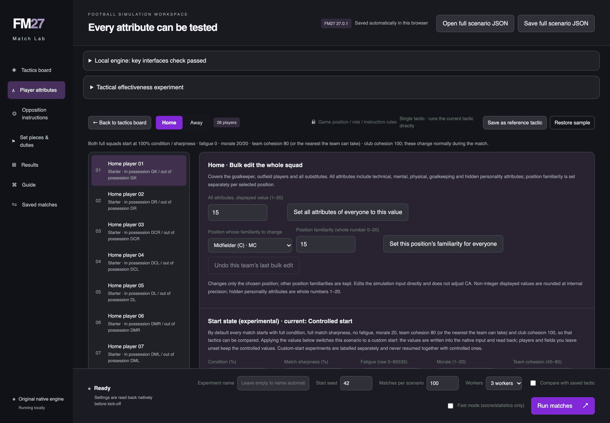
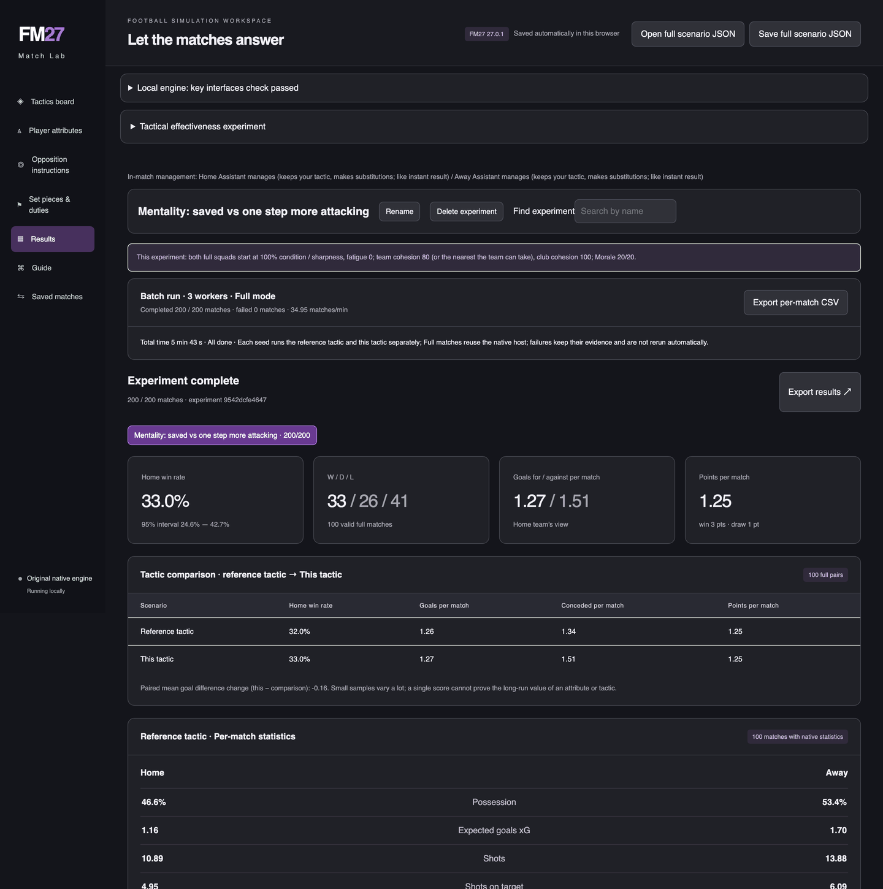

# FM27 Match Lab for macOS

Run Football Manager 27's own match engine on your Mac, outside the game: replay matches you played, change
attributes, lineups, tactics, instructions or set pieces, and simulate thousands of matches to see what difference
the change makes.

It loads the unchanged match engine from **your own Steam install** of FM27 and drives it headlessly. Nothing from the
game is included in this repository.

This project began as a macOS port of [FM Tactics Lab](https://github.com/lqf0624/fm-tactics-lab) by **lqf0624**
(Windows, MIT licence). The browser UI, scenario model and much of the server come from that project. The macOS
engine host, address mapping, saved-match replay, in-match management and the studies are new. Upstream is now a
reference only: this repository is macOS-only and does not track or support the Windows tool.

> Personal-use interoperability project. Not affiliated with or endorsed by Sports Interactive or SEGA. Football
> Manager is their trademark.



## What you can do

- **Replay your own matches.** Open any match FM27 saved, replay it exactly (same score, xG, shots and goal minutes
  as the game showed), then change something and see how the match would have gone.
- **Batch simulations.** Run hundreds or thousands of seeds of a scenario on several workers (about 3 s per match
  per worker) and compare results: points, goals, xG, shots, possession, cards, substitutions and minutes.
- **Edit everything the engine reads:** player attributes and profiles, lineups, formations, roles and duties, team,
  player and opposition instructions, set-piece takers and routines, and who manages each side during the match
  (your assistant, a fixed tactic or the AI manager).
- **Import and export FM27 tactics** (`.fmf`) and set-piece routines through the game's own parser.

## League: many tactics against each other

The **League** page plays any number of tactics (2 to 20) against each other, home and away, over several seasons:
FM27 presets, your `.fmf` files, or a whole folder of them. By default every team has the same **synthetic reference
squad** (Premier League, middle eight), so only the tactics differ; you can also use the top-six or bottom-six
reference squads, a real squad from one of your matches or from your save (fmsave), or levelled squads. Both sides
start alike, tactical familiarity is held at one level, and the results show the table averaged over seasons with
the spread across seasons, a head-to-head grid and a CSV export. `scripts/study.py league` runs the same leagues from
the command line (`--reference pl-middle --equal-start`).

The reference squads are synthetic: invented players calibrated on FM27's database (27.0.1, database 27.0.0, Premier
League clubs at the start of the 2026/27 season), generated by `scripts/reference_squads.py`; see
THIRD_PARTY_NOTICES.md.

## Studies on your own matches

For questions with many conditions ("what is each attribute worth for my team?"), `scripts/study.py` replays your
saved matches under each condition on the same seeds and reports paired differences with t values:

```sh
.venv/bin/python scripts/study.py new runs/my-study --team "Your Club" --newest 10
.venv/bin/python scripts/study.py add runs/my-study attributes familiarity:20 instructions
.venv/bin/python scripts/study.py run runs/my-study        # resumable
.venv/bin/python scripts/study.py report runs/my-study
```

| Player editor | Results of a comparison |
|---|---|
|  |  |

Screenshots show the sample match, where the app uses generic player names.

Leagues and squads from your saves:

```sh
# every tactic against every other, home and away, with the table and head-to-head results
.venv/bin/python scripts/study.py league runs/league --team "Your Club" --tactics presets "tactics:~/Downloads/fm27-tactics"
# the same with one club's players from your save on both sides (pip install fmsave)
.venv/bin/python scripts/study.py league runs/league2 --team "Your Club" --tactics presets --squad "career.fm:Chelsea"
# FM27's in-match Tactical Tweaks, applied from kick-off, against a chosen opposition tactic
.venv/bin/python scripts/study.py new runs/tweaks --team "Your Club" --opponent-tactic "preset:Gegenpress"
.venv/bin/python scripts/study.py add runs/tweaks tweaks
# search for better team instructions and mentality across your saved matches (some held out for the final check)
.venv/bin/python scripts/optimise.py runs/opt --team "Your Club"
# the same with your current squad against many real opponents (other clubs' matches and this season's fixtures),
# all your saved matches held out for the final check (needs fmsave)
.venv/bin/python scripts/import_other_matches.py
.venv/bin/python scripts/optimise.py runs/opt2 --team "Your Club" --save "<your save>.fm"
```

**Your matches are kept.** FM27 keeps only your last 10 saved matches; the app and the scripts copy each new one to
a backup (`~/fm27-port-work/saved_matches`) when they start, and also keep the inputs of other clubs' matches that
FM27 leaves in its `Temporary` folder (`scripts/import_other_matches.py` makes them playable).

**What we found:** [docs/FINDINGS.md](docs/FINDINGS.md) summarises eight studies of the engine (about 220,000
matches) and the first tactic search; the full studies are in [docs/studies/](docs/studies/README.md). Using an AI agent? Point it at
[AGENTS.md](AGENTS.md): the rules, the set-up and how to design and read a study.

## Requirements

- macOS on Apple Silicon (via Rosetta 2) or Intel.
- FM27 installed through Steam, at a supported build: **27.0.0** (2493426), **27.0.1** (2494769) or the **27.0.1
  hotfix of 12 November** (2503222, installed automatically by Steam). Other builds are refused until they have been
  mapped: the set-up stops with "Unsupported FM27 build", and the app runs nothing (see "Updating after an FM27
  patch" in the [guide](docs/MACOS.md)).
- After Steam updates FM27 to a supported build, or after you update this repository, run `scripts/setup.py` again
  (FM27 closed); until then the app says FM27 has been updated since the set-up and runs nothing.
- Steam running and logged in. The tool does not bypass or emulate Steam, DRM or any online service.
- Python 3.12 and the Xcode command line tools (`clang++`, `codesign`).
- FM27 closed during set-up. Simulations can run while you play; both just run slower.

## Set-up

```sh
git clone https://github.com/caiograco289/Fm-Match-Lab.git && cd Fm-Match-Lab
python3.12 -m venv .venv                       # the app itself needs only the standard library
.venv/bin/pip install UnityPy                  # used once by the set-up, to read the game's tactic data
.venv/bin/python scripts/setup.py              # one-off, and again after a game update
.venv/bin/python scripts/run.py                # then open http://127.0.0.1:18765
```

`setup.py` builds the engine host for your installed FM27, builds the tactic catalogue (roles, instructions,
policies) from the game's own data, and makes your newest saved match the sample match. Play at least one match in
FM27 first (instant result is fine). It reads the game's files and runs its engine functions; it never changes them.

Tests: `.venv/bin/python -m unittest discover tests` (add `FM27_INTEGRATION=1` to also replay your newest saved
match through the engine).

Everything derived from your game files stays in the git-ignored folders `private/`, `build/` and `data/`.

## Documentation

- [docs/MACOS.md](docs/MACOS.md): full guide: what works, saved matches, in-match management, game updates.
- [docs/studies/](docs/studies/README.md): engine studies (attribute values, familiarity, tactics, …).
- [docs/RESEARCH.md](docs/RESEARCH.md): running the engine host directly; research switches.
- [port/REPORT.md](port/REPORT.md): the technical notebook of the port: how each engine function was located and
  validated, with all findings and corrections.
- [port/PLAN.md](port/PLAN.md): the original port plan and ground rules.

## Licence

MIT, see [LICENSE](LICENSE). The licence covers this repository's code only; it does not cover the game or anything
derived from it. See [THIRD_PARTY_NOTICES.md](THIRD_PARTY_NOTICES.md).
