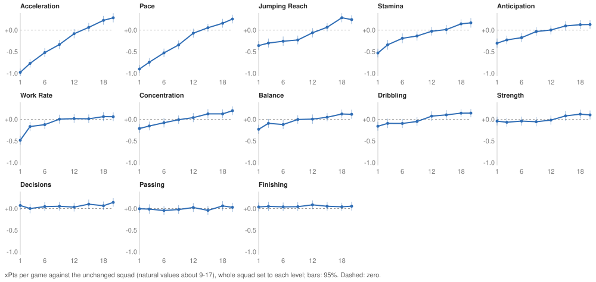

# Study 12: are there thresholds? Attributes from 1 to 20

**Status:** done (13 November, 21,000 matches). Two questions:
- **A threshold?** Is there a minimum value below which an attribute collapses (the "8 minimum" claim), or does each
  point pay the same from 1 to 20?
- **Does the attribute guide's shape hold?** The current FM27 attribute guide on FM Arena, by HarvestGreen, is built
  from tests at 1, 6, 12 and 18 with straight lines assumed between them. It says:
  - Work Rate, Anticipation and Strength "hurt a lot below 6 but don't improve much above 12";
  - Jumping Reach "does not help much below 6" but "is one of the most important above 12".

  A reader there asked whether the 6-12 band holds.

**In short:**
- **Most attributes pay roughly a straight line from 1 to 20,** with no floor.
- **Four clearly don't:**
  - **Work Rate:** a floor. It costs a lot at 1, a little at 3-6, and nothing from 9 up.
  - **Stamina:** steepest below 4.
  - **Pace and Acceleration:** pay more per point below about 12 than above.
  - **Jumping Reach:** the opposite, pays little below 9 and a lot above.
- **The guide's description holds** for Work Rate and Jumping Reach, partly for Strength, and not for Anticipation,
  which is close to a straight line.
- **A side finding: Strength works through goals rather than chances.** Its value shows in points and goals but
  hardly in xG, which is why xG-based tables (including Studies 1, 9 and 10) undervalue it.

## Design

- **Neutral ground,** as in Studies 7, 9-11 and 20:
  - The synthetic Premier League middle-eight squad on both sides, Gegenpress.
  - Tactical familiarity held at 80.
  - Four preset opponents, home and away.
  - Two template matches between other clubs.
- **Levels:** the whole squad's attribute set to 1, 3, 6, 9, 12, 15, 18 and 20, one attribute at a time; everything
  else as in the squad. The guide's 1, 6, 12 and 18 are among them, so its straight-line assumption between those
  steps can be checked.
- **Thirteen attributes:** Pace, Acceleration, Stamina, Work Rate, Anticipation, Strength, Jumping Reach,
  Concentration, Balance, Dribbling, Passing, Decisions, Finishing.
  - The squad's own values are mostly 9-17 (medians 12-14).
  - Exceptions: Jumping Reach 6-18; Dribbling and Finishing as low as 1-2 for defenders.
- **Paired:** 25 seeds, giving 200 pairs per level, each against the same matches with the squad unchanged.
- **Fit:** for each attribute, a straight line against a two-segment line with the knee anywhere from 3 to 18.
  - The fit is generalised least squares, with the covariance between levels estimated from the pairs, because all
    levels share the same unchanged matches.
  - With the knee searched over 16 positions, a chi-square gain below about 8 is what chance gives.

## The curves



Expected points (xPts) per game against the unchanged squad; per season, multiply by 38:

| Attribute | 1 | 3 | 6 | 9 | 12 | 15 | 18 | 20 | Per point (t) | Knee | Per point below / above | Chi-square gain |
|---|---|---|---|---|---|---|---|---|---|---|---|---|
| Acceleration | −0.98 | −0.77 | −0.52 | −0.33 | −0.08 | +0.06 | +0.22 | +0.28 | +0.068 (39) | 11 | +0.082 / +0.049 | **16.7** |
| Pace | −0.90 | −0.74 | −0.53 | −0.34 | −0.07 | +0.05 | +0.16 | +0.25 | +0.062 (34) | 13 | +0.073 / +0.038 | **17.0** |
| Jumping Reach | −0.36 | −0.30 | −0.26 | −0.23 | −0.06 | +0.07 | +0.28 | +0.24 | +0.035 (17) | 9 | +0.019 / +0.047 | **10.3** |
| Stamina | −0.53 | −0.34 | −0.19 | −0.14 | −0.03 | +0.01 | +0.14 | +0.17 | +0.034 (17) | 4 | +0.092 / +0.026 | **13.0** |
| Anticipation | −0.30 | −0.23 | −0.18 | −0.03 | +0.00 | +0.10 | +0.12 | +0.13 | +0.024 (12) | 16 | +0.029 / −0.000 | 4.5 |
| Work Rate | −0.48 | −0.17 | −0.12 | +0.00 | +0.02 | +0.01 | +0.06 | +0.06 | +0.022 (10) | 3 | +0.168 / +0.014 | **43.8** |
| Concentration | −0.21 | −0.15 | −0.08 | −0.01 | +0.04 | +0.13 | +0.13 | +0.20 | +0.021 (11) | | straight line | 0.7 |
| Balance | −0.23 | −0.09 | −0.12 | −0.00 | +0.00 | +0.05 | +0.12 | +0.12 | +0.017 (9) | | straight line | 3.4 |
| Dribbling | −0.16 | −0.09 | −0.10 | −0.05 | +0.07 | +0.10 | +0.14 | +0.14 | +0.017 (8) | | straight line | 0.7 |
| Strength | −0.04 | −0.07 | −0.04 | −0.06 | −0.02 | +0.08 | +0.12 | +0.10 | +0.009 (5) | | straight line | 4.2 |
| Decisions | +0.07 | −0.00 | +0.04 | +0.05 | +0.03 | +0.10 | +0.06 | +0.14 | +0.005 (3) | | straight line | 2.2 |
| Passing | −0.01 | −0.01 | −0.05 | −0.02 | +0.02 | −0.04 | +0.06 | +0.03 | +0.003 (1) | | nothing | 1.4 |
| Finishing | +0.04 | +0.05 | +0.04 | +0.04 | +0.09 | +0.05 | +0.04 | +0.05 | +0.000 (0) | | see goals below | 0.5 |

All levels are compared with the same 200 unchanged matches, so a whole row can sit a little above or below zero
together (Finishing's +0.05 everywhere is such an offset). Read the shape of each row, not its level.

- **Pace and Acceleration are the biggest by far.** From 1 to 20 they are worth about 1.2 xPts per game. Below 12
  each point is worth about 0.08 (3 points a season); above 12, about 0.04-0.05. So there's no floor, just
  diminishing returns at the top.
- **Work Rate has a floor.** Work Rate 1 costs half a point per game; 3 and 6 cost a little (−0.17, −0.12); from 9 to
  20 it makes no difference. This is the clearest threshold in the study.
- **Stamina falls away fastest below 4,** then gains about 0.03 per point.
- **Jumping Reach pays at the top.** It is flat from 1 to 9 (0.02 per point), then about 0.05 per point above.
  Going from 12 to 18 is worth +0.34 xPts per game, more than any other attribute over that range.
- **Concentration, Balance, Dribbling and Anticipation are straight lines.** No knee improves the fit beyond chance.
  Anticipation flattens above 15, but not significantly.
- **Passing and Decisions are close to nothing at every level,** as in Studies 9, 10 and 20. Even a whole squad at
  Passing 1 does no measurably worse within a match.

## Strength and Finishing: goals, not chances

xPts is computed from expected goals, so it sees only how many chances a side makes and how good they are, not how
well they are taken. Two attributes act on conversion, measured as goals minus xG (change from 1 to 20 on a fitted
straight line):

| Attribute | Goals minus xG, for | Goals scored | Points | xPts |
|---|---|---|---|---|
| Strength | **+0.50 per game (t 7.3)** | +0.62 (t 7.6) | +0.69 (t 7.9) | +0.18 (t 4.7) |
| Finishing | +0.29 per game (t 3.8) | +0.20 (t 2.4) | +0.19 (t 2.0) | +0.00 (t 0.0) |

- **Strength turns the same chances into more goals.** Plausibly, stronger players win the contact in the box and
  get cleaner shots away than the xG model assumes. On points, Strength is a fairly strong attribute:
  - −0.48 per game at 1 and −0.33 at 3, against the unchanged squad;
  - +0.09 to +0.31 from 9 up.
- **On points, the guide's Strength claim holds:** it "hurts a lot below 6" and improves less above 12.
- **Finishing raises conversion, as it should,** by about 0.3 goals per game from 1 to 20. In points that is too
  small to be sure of with 200 pairs.
- **On the defending side,** Pace lowers the goals the opponent scores below their xG (−0.32 per game from 1 to 20,
  t −4.3); no other attribute does clearly.
- **Earlier pages undervalue Strength.** Studies 1, 9 and 10 rank attributes by xPts and xG difference, which miss
  this. In Study 10, Strength +5 was worth +0.15 points per game (t 2.3) with no change in xPts; that is the same
  effect.

## The guide's claims, checked

| Claim | This study (within a match) |
|---|---|
| Work Rate hurts a lot below 6, improves little above 12 | **Holds.** Most of the damage is at 1-3; flat from 9. |
| Anticipation hurts a lot below 6, improves little above 12 | **Not really.** Close to a straight line from 1 to 15 (about 0.03 per point), flattening after. No floor. |
| Strength hurts a lot below 6, improves little above 12 | **Holds on points and goals,** not on xG (see above). |
| Jumping Reach doesn't help much below 6, one of the most important above 12 | **Holds.** Flat to 9, then the steepest gain of any attribute from 12 to 18. |
| The 6-12 minimum band | **Only for Work Rate and Stamina,** where values below about 6 cost clearly more per point. Pace, Acceleration and most others have no floor: each point pays all the way, more below 12 than above. |
| Straight lines between 1, 6, 12 and 18 | A good approximation for most attributes. It misses the floor in Work Rate between 1 and 6, and the jump in Jumping Reach between 12 and 18. |

## Caveats

- **Whole squad at one level.** Real squads mix values. A single player at Work Rate 1 surrounded by normal
  team-mates is not tested; Study 13 looks at positions.
- **One squad, one style.** Premier League middle eight, Gegenpress. A style that relies less on running could have a
  different Work Rate floor.
- **200 pairs per level.** Enough for the shapes above. Small knees (in Anticipation, Balance or Strength's xPts) need
  more seeds to settle.
- **Within a match.** Effects over a season (injuries from low Stamina, training, development) are not measured.
- **Tactical familiarity is held at 80** for both sides, and tactical complexity is not recomputed by the match
  engine (see the main README).

## Reproduce

```sh
.venv/bin/python port/validation/neutral_study.py build 12 runs/study12
.venv/bin/python port/validation/neutral_study.py pilot runs/study12 --workers 7
.venv/bin/python port/validation/neutral_study.py run runs/study12 --workers 7      # about 3 hours with 7 workers
.venv/bin/python port/validation/neutral_study.py report runs/study12
.venv/bin/python port/validation/dose_response.py runs/study12                    # fits; --measure pts, GF, xGD ...
.venv/bin/python port/validation/dose_chart.py runs/study12 docs/studies/img/12-dose-response.svg
```
